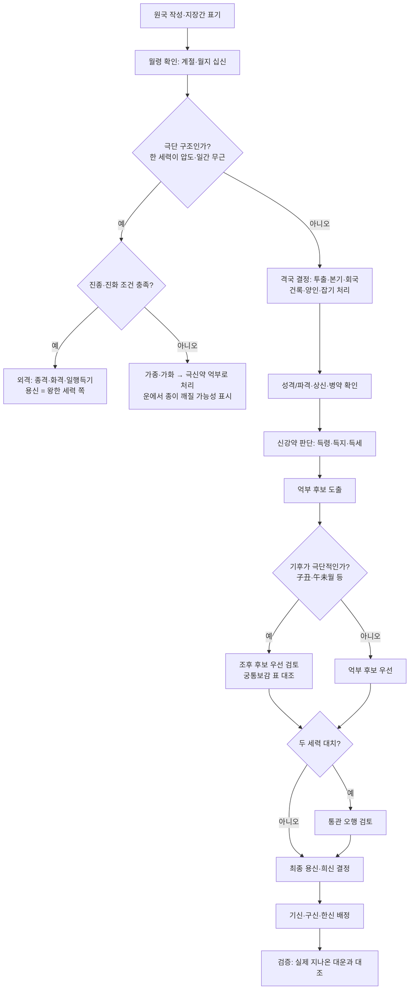

# 04. 격국(格局)·용신(用神)·조후(調候)

> **이 문서의 위치**: `03`에서 십신과 신강약을 읽었다면, 이 문서는 **"이 사주는 어떤 구조이고 무엇이 필요한가"**, 곧 해석의 두 번째 층위를 다룹니다. 운(運) 해석은 `05`에서 다룹니다.
>
> **전제**: 명리학은 과학적으로 검증된 예측 체계가 아니라 **전통 해석 체계**입니다. 특히 5장의 "오행 보완 생활 응용(색·방위·직업)"은 전통 이론 안에서도 근거가 약한 **대중적 응용**입니다.
>
> **조사 방법 메모**: 웹 검색 결과 요약으로 원문과 출처를 확인했습니다. 네트워크 정책 때문에 원문 페이지를 직접 열지는 못했습니다. 원문과 대조하지 못한 구절과 표에는 **(미확인)** 또는 **(통용 표, 원전 대조 미완)** 을 붙였습니다.
>
> **2026-10-28 원문 대조 보강**: 이번에는 원문 전자판을 직접 열어 대조했습니다. 『궁통보감』 전문(維基文庫)[^47], 『적천수천미』 전문[^48]과 『적천수집요』 분장본[^49], 『자평진전』 원문(各 장 앞부분 약 500자 공개본)[^50], 『삼명통회』 권1~9[^51], 『연해자평』[^52]입니다. 직접 연 원문과 맞춘 곳은 **「원문 확인」** 으로 표시했습니다. ctext.org 는 보안 확인 화면에 막혀 열지 못했습니다.

---

## 목차

1. [세 고전과 세 가지 관점](#1-세-고전과-세-가지-관점)
2. [격국론(格局論)](#2-격국론格局論)
3. [용신론(用神論)](#3-용신론用神論)
4. [『적천수』의 핵심 개념](#4-적천수의-핵심-개념)
5. [용신 판단 실전 절차](#5-용신-판단-실전-절차)
6. [오행 과다·부족 해석과 생활 응용 (근거 약함)](#6-오행-과다부족-해석과-생활-응용-근거-약함)

---

## 1. 세 고전과 세 가지 관점

| 고전 | 저자·성립(통설) | 중심 개념 | 용신을 보는 법 |
|---|---|---|---|
| 『자평진전(子平眞詮)』 | 청(淸) 심효첨(沈孝瞻). 서락오(徐樂吾) 평주본이 널리 유통 | **격국(格局)**, 월령 | 월령에서 격을 세우고, 격을 이루게 하는 **상신(相神)** 을 찾음 |
| 『적천수(滴天髓)』 | 저자 논란(송 경도 京圖 설, 명 유기 劉基 설). 청 임철초(任鐵樵) 주 『적천수천미(闡微)』, 서락오 보주[^5][^8] | **쇠왕(衰旺)·중화(中和)·체용(體用)** | 일간 강약에 따라 억(抑)·부(扶)하여 **중화**를 이룸 |
| 『궁통보감(窮通寶鑑)』 | 원저 『난강망(欄江網)』, 청 여춘태(余春台) 편집본(통설, 미확인) | **조후(調候)**: 한난조습 | 일간 × 출생월의 기후에 맞는 천간을 고름 |

- 국내 학위논문 중에도 세 고전의 용신론 연원과 차이를 비교하고 실제 명조에 적용한 연구가 있습니다[^28]. 『자평진전』의 기저 이론, 월령용신, 격국 분류(정격·외격·변격·겸격), 성패 변화를 다룬 학위논문도 있습니다[^2].
- 학술 논문은 용신을 사주 구조의 불균형을 조절하는 기준으로 보고, **억부·조후·격국·병약·통관**을 함께 정리합니다[^29].
- 진소암(陳素庵)의 『명리약언(命理約言)』을 다룬 연구는 "격국을 정한 뒤 중화를 위한 억부용신을 찾아야 한다"며 **격국론과 억부론의 결합**을 주장한 점에 주목합니다[^27]. 현대 한국 실무의 주류도 이 절충형에 가깝습니다(통용 견해).

> **용어 주의: "용신"의 두 가지 뜻**
> - 『자평진전』의 용신 = **월령에서 취한 격의 주체**(예: 정관격이면 정관이 "용신"). 그것을 돕거나 제어하는 글자는 **상신(相神)** 이라고 부릅니다.
> - 현대 통용(억부·조후 계열)의 용신 = **사주의 균형을 위해 가장 필요한 오행 또는 천간**.
> 두 개념을 섞으면 "정관격인데 용신이 인성"처럼 모순된 문장이 나오므로, 사이트 문구에서는 **"격(格)"과 "용신(필요 오행)"을 구분해 표기**하기를 권합니다.

---

## 2. 격국론(格局論)

### 2.1 출발점: 월령(月令)

> 八字用神，專求月令，以日干配月令地支，而生剋不同，格局分焉。
> (팔자의 용신은 오로지 월령에서 구한다. 일간을 월령 지지에 짝지어 생극이 달라지니 격국이 나뉜다.)
> — 『子平眞詮』「論用神」[^1][^50] (원문 확인)

같은 장에 따르면 월령에 쓸 만한 것이 없으면 다른 기둥의 투간·회지(會支)에서 취하되, 그래도 월령을 주로 한다는 취지의 서술이 이어집니다[^1]. 첫 구절은 沈孝瞻 원문 공개본에서 "八字用神，專求月令，以日干配月令地支，而生剋不同，格局分焉。財官印食，此用神之善而順用之者也；煞傷劫刃，用神之不善而逆用之者也"로 확인했습니다[^50]. "八字用神專憑月令，月無用神，始尋格局"처럼 문구가 다른 이본도 유통됩니다(이본 대조 미완, 미확인).

### 2.2 격 정하는 순서 (자평진전 계열 실무 절차)

```text
STEP 1  월지(月支)를 확인한다.
STEP 2  월지 지장간 중 천간에 투출(透出)한 것이 있는가?
        ├─ 본기(정기)가 투출 → 그 십신으로 격을 정한다 (가장 우선)
        ├─ 본기는 없고 중기·여기가 투출 → 투출한 것으로 격을 정한다는 견해가 일반적
        │    (여러 개가 투출하면 세력이 강한 것, 또는 본기 쪽을 우선 — 학파차)
        └─ 투출 없음 → 월지 본기로 격을 정한다
STEP 3  월지가 삼합·방합 회국(會局)을 이루면 회국 오행으로 격을 정하는 견해가 있다
STEP 4  월지가 일간의 비겁(건록·양인=월겁)이면 → 건록격·양인격(월겁격)
        → 비겁 자체는 용신이 될 수 없으므로 다른 기둥의 재·관·식상에서 용(用)을 취한다
STEP 5  월지가 辰戌丑未(잡기·雜氣)면 → 투간한 지장간을 우선해 취용한다
STEP 6  성격(成格)·파격(破格)을 판정하고 상신(相神)을 찾는다
STEP 7  정격으로 설명이 안 되는 극단 구조 → 외격(종격·화격·일행득기 등)을 검토한다
```

> STEP 2의 세부 우선순위(여기 vs 중기, 다수 투출 시)와 STEP 3 회국 우선 여부는 학파와 주석가마다 다릅니다.
>
> **원문 확인(2026-10-28)**[^50] — 세 장의 첫머리를 원문 공개본과 대조했습니다.
> - STEP 2 근거, 「論用神變化」: "用神既主月令矣，然月令所藏不一，而用神遂有變化…即以寅論，甲為本主…丙其長生…戊亦長生…假使寅月為提，不透甲而透丙，則如知府不臨郡，而同知得以作主"(본기가 투출하지 않고 장생 글자가 투출하면 그 글자가 주인이 된다). 같은 장은 "丁生亥月，本為正官，支全卯未，則化為印"이라고 하여 **STEP 3 회국 변화**도 인정합니다.
> - STEP 5 근거, 「論雜氣如何取用」: "四墓者，沖氣也，何以謂之雜氣？以其所藏者多，用神不一…透干會支，取其清者用之…一透則一用，兼透則兼用，透而又會，則透與會並用"(徐樂吾 평주본 계열에는 "四墓者，雜氣也"로 된 이본이 있다는 검색 발췌가 있음, 미확인).
> - STEP 4 근거, 「論建祿月劫」: "建祿者，月建逢祿堂也，祿即是劫…故建祿與月劫，可同一格，不必加分，皆以透干支，別取財官煞食為用"(건록과 월겁은 같은 격으로 묶고, 투간·회지한 재·관·살·식에서 따로 용을 취한다).

### 2.3 성격(成格)·파격(破格)·상신(相神)

- **성격**: 격의 주체(용신)가 상신의 도움으로 제자리를 얻은 상태. 예) 정관격 + 재성이 관을 생함 + 상관이 없음.
- **파격**: 격을 깨뜨리는 요소가 있는 상태. 예) 정관격에 상관이 정관을 침.
- **구응(救應)**: 파격 요소를 다시 제어하는 글자가 있으면 격이 회복됩니다. 예) 상관이 관을 치지만 인성이 상관을 제어함.
- **순용·역용**: 재·관·인·식은 생하고 보호하는 방향으로(순용), 살·상·효·인(刃)은 제어하는 방향으로(역용) 씁니다[^1]. 원문은 "七煞喜食神以制伏，忌財印以資扶；傷官喜佩印以制伏，生財以化傷；陽刃喜官煞以制伏，忌官煞之俱無；月劫喜透官以制伏"입니다(「論用神」, 원문 확인)[^50].
- **상신(相神)의 원문 정의**: "月令既得用神，則別位亦必有相…如官逢財生，則官為用，財為相；財旺生官，則財為用，官為相；煞逢食制，則煞為用，食為相"(「論相神緊要」, 원문 확인)[^50].

### 2.4 정격(正格) 8격과 관련 격 요약

| 격 | 월령 조건 | 성격 조건(대표) | 파격 조건(대표) | 해석 키워드 |
|---|---|---|---|---|
| **정관격(正官格)** | 월령 정관 | 재성이 관을 생(財生官), 인성이 관을 보호(官印相生), 상관 없음 | 상관견관(傷官見官), 관살혼잡, 관이 형충됨 | 명예, 조직, 공직, 책임 |
| **재격(財格)** (정재·편재) | 월령 재성 | 신강하여 재를 감당, 식신이 재를 생, 재가 관을 생 | 비겁이 재를 빼앗음(군비쟁재), 신약재다 | 재물, 사업, 현실 감각 |
| **인수격(印綬格)** (정인·편인) | 월령 인성 | 관살이 인을 생(官印·殺印相生), 인이 너무 많으면 재로 덜어 냄 | 재성이 인을 깨뜨림(財破印) | 학문, 자격, 보호, 문서 |
| **식신격(食神格)** | 월령 식신 | 식신생재, 식신제살 | 편인이 식신을 침(효신탈식·梟神奪食) | 재능, 생산, 여유 |
| **편관격(偏官格)·칠살격** | 월령 편관 | 식신제살, 살인상생, 양인합살 | 제어 장치 없이 살이 왕하고 신약, 재가 살을 생해 키움 | 권력, 위기 대응, 강한 조직 |
| **상관격(傷官格)** | 월령 상관 | 상관패인(傷官佩印), 상관생재 | 상관견관(특히 정관이 노출) | 창의, 언변, 예술, 개혁 |
| **양인격(陽刃格)** | 월령이 일간의 양인 | 관살로 양인을 제어(양인가살·양인용관) | 관살이 없거나 충을 받음 | 강력한 추진력, 무관·전문 기술 |
| **건록격(建祿格)** | 월령이 일간의 녹(건록) | 다른 기둥의 재·관·식상을 용(用)으로 씀 | 재·관·식상이 모두 없고 비겁만 많음 | 자수성가, 독립심 |

- 양인격·건록격은 월령이 비겁이라 "비겁 자체는 용신이 될 수 없다"는 원칙 때문에 별도로 다룹니다. **월겁격(月劫格)**(음간의 월령 겁재)을 건록격과 묶는 처리도 있습니다(국내 학위논문 목차에서도 "月建祿格·月劫財格"을 따로 분류한 예가 보임)[^2].
- 세부 성패 조건은 『자평진전』 각 격 장(論正官, 論財, 論印綬, 論食神, 論偏官, 論傷官, 論陽刃, 論建祿月劫)에 길게 나옵니다. 위 표는 그 통용 요약입니다(통용 요약). 2026-10-28에는 장마다 첫머리 약 500자만 원문으로 대조했습니다[^50].
  - 정관격 행(원문 확인): "以刑沖破害為忌，則以生之護之為喜…以財印並透者論之，兩不相碍，其貴也大"(「論正官」). 표의 "재생관·관인상생, 형충을 꺼림"과 맞습니다.
  - 건록격 행(원문 확인): "禄格用官，干頭透出為奇，又要財印相隨，不可孤官無輔…禄劫用財，須帶食傷"(「論建祿月劫」). 표의 "다른 기둥의 재·관·식상을 씀"과 맞습니다.
  - 나머지 행(재·인수·식신·편관·상관·양인)은 장 본문 대조 미완입니다(미확인).

### 2.5 외격(外格)

정격의 "억부·상신" 논리로 설명되지 않는 **극단적 구조**를 외격이라고 합니다.

> **『자평진전』의 외격 정의 (원문 확인)**[^50]: "八字用神既專主月令，何以又有外格乎？外格者，蓋因月令無用，權而用之，故曰外格也…若月令自有用神，豈可另尋外格？…書云'提綱有用提綱重'，又曰'有官莫尋格局'"(「論外格用舍」). 곧 **월령에 쓸 것이 정말 없을 때만** 외격을 쓰고, 재가 겁을 당하거나 관이 상을 당한 것(용신이 깨진 것)을 "월령 무용"으로 착각해 외격으로 넘어가는 것은 "謬之又謬"라고 경계합니다.

#### (1) 종격(從格)

> 從得真者只論從，從神又有吉和凶。
> (따름이 참되게 이루어진 경우에는 따름만 논한다. 다만 따르는 신에도 길흉이 있다.)
> — 『滴天髓』「從象」[^8] (『적천수집요』 「從化論－真」에서 원문 확인[^49])

임철초 주의 요지: 일간이 **고립무기(孤立無氣)** 하여 천·지·인 어디에도 생조가 없고 재관이 강성해야 **진종(眞從)** 이며, 이후에는 따르는 신만 논한다. 같은 종격이라도 계절과 유통에 따라 필요한 것이 달라진다[^8].

- **판본 차이 (원문 확인)**: 維基文庫 『적천수천미』 본에는 이 조문 자리에 "孤立無氣唯有從，依得財官享富貴。(原文缺，此後人按原注意補)"가 실려 있습니다. 원문이 빠져 후대 사람이 원주를 바탕으로 보충했다는 주기입니다[^48]. 반면 『집요』 본에는 "從得真者只論從…"이 그대로 있습니다[^49].
- **종왕·종강·종세의 출처 (원문 확인)**: 임철초는 「從象」 주에서 "尚有從旺、從強、從氣、從勢之理…此四從，諸書所未載，余之立說"이라고 했습니다[^48]. 곧 아래 표의 **종왕격·종강격·종세격은 『적천수』 본문이 아니라 임철초가 새로 세운 설**입니다.

| 종격 | 조건(통용) | 용신 방향 |
|---|---|---|
| 종재격(從財格) | 일간 무근, 재성이 압도 | 재성과 재를 생하는 식상 |
| 종살격(從殺格)·종관격 | 일간 무근, 관살이 압도 | 관살과 관살을 생하는 재성 |
| 종아격(從兒格) | 일간 무근, 식상이 압도 | 식상과 재성 |
| 종세격(從勢格) | 식상·재·관이 섞여 강하고 일간 무근 | 세력의 중심, 유통 |
| 종강격(從强格) | 인성이 압도하고 비겁이 따름 | 인성·비겁(극하는 운을 꺼림) |
| 종왕격(從旺格) | 비겁이 압도 | 비겁·인성(관살 운을 꺼림) |

- **진종(眞從) vs 가종(假從)**: 일간에 미약한 뿌리가 남아 있으면 가종이라 하며, 운에서 뿌리가 살아나면 종이 깨진다고 봅니다(통용 견해).
- **학파 차이**: 종격을 넓게 인정하는 쪽(적천수 계열)과, 종격 판정을 엄격히 제한하고 대부분을 신약으로 보아 억부를 적용하는 쪽이 있습니다. 같은 명조를 놓고 **종격인지 극신약인지**에 따라 용신이 정반대가 되므로 실무에서 가장 판단이 갈리는 부분입니다.

#### (2) 화기격(化氣格)

> 化得真者只論化，化神還有幾般話。
> — 『滴天髓』「化象」[^8] (원문 확인[^48][^49])
>
> 『집요』 원주(원문 확인)[^49]: "如甲日主，生於四季，單遇一位己土，在月時上作合（在年干不是），不遇壬癸甲乙庚，乃為化得真…又如丙辛生於冬月，戊癸生於夏月，乙庚生於秋月，丁壬生於春月，獨相作合，皆為真化". 아래 표의 "성립에 유리한 월령"은 이 원주와 맞습니다.

| 화격 | 합 | 성립에 유리한 월령(통용) |
|---|---|---|
| 화토격 | 甲己合 | 辰戌丑未월 (土 왕절) |
| 화금격 | 乙庚合 | 申酉월(가을), 巳酉丑 |
| 화수격 | 丙辛合 | 亥子월(겨울), 申子辰 |
| 화목격 | 丁壬合 | 寅卯월(봄), 亥卯未 |
| 화화격 | 戊癸合 | 巳午월(여름), 寅午戌 |

- 성립 조건은 `03` 7.4 체크리스트를 따릅니다(일간과 인접한 합, 월령, 화신의 세력, 방해 없음)[^8].
- 진화가 되면 **화신(化神)이 일간 역할**을 하고, 화신의 강약·한난에 따라 다시 용신을 정합니다. 임철초 주는 甲己가 토로 화하면 한토(寒土)는 화(火)로 데워야 하고, 토가 너무 왕하면 수·목·금을 쓴다는 식으로 설명합니다[^8].

#### (3) 일행득기격(一行得氣格)·전왕격(專旺格) (통용 분류)

| 격 | 일간 | 조건 |
|---|---|---|
| 곡직격(曲直格)·곡직인수격 | 甲乙 | 寅卯辰 방합 또는 亥卯未 삼합, 金 없음 |
| 염상격(炎上格) | 丙丁 | 巳午未 또는 寅午戌, 水 없음 |
| 가색격(稼穡格) | 戊己 | 辰戌丑未 다수, 木 없음 |
| 종혁격(從革格) | 庚辛 | 申酉戌 또는 巳酉丑, 火 없음 |
| 윤하격(潤下格) | 壬癸 | 亥子丑 또는 申子辰, 土 없음 |

- 그 밖에 **양신성상격(兩神成象格)**: 두 오행이 대등하게 사주를 양분하는 구조(예: 목화·수목)도 외격으로 다룹니다.
- 비천록마(飛天祿馬)·도충(倒沖)·정란차(井欄叉) 등 **허자(虛字)를 끌어오는 잡격(雜格)** 은 『적천수』 임철초 주와 현대 자평학파 대부분이 비판하거나 쓰지 않습니다[^34].
  - **원전 비판 구절 (원문 확인)**: 『연해자평』 「論日爲主」에 "倘有妄立格局，從列其名，而無實用，其飛天祿馬、倒沖井欄叉，即傷官，析而為之"가 있습니다(쓸데없이 격국을 세워 이름만 늘어놓았으며, 비천록마·도충·정란차는 상관을 쪼개 만든 것일 뿐)[^52].
  - 다만 『자평진전』 「論外格用舍」는 월령에 쓸 것이 없을 때에 한해 "類象、屬象、沖財、會祿、刑合、遙迎、井欄、朝陽諸格，皆可用也"라고 하여 일부 잡격을 **조건부로 인정**합니다(원문 확인)[^50]. 따라서 "자평학파가 잡격을 전부 부정한다"고 쓰면 정확하지 않습니다.

---

## 3. 용신론(用神論)

### 3.1 용신의 다섯 가지 취용법

| 취용법 | 질문 | 언제 우선하나 |
|---|---|---|
| **억부(抑扶)** | 일간이 강한가 약한가? 강하면 덜고 약하면 돕는다 | 대부분의 정격 명조의 기본 |
| **조후(調候)** | 너무 춥거나 덥거나, 습하거나 건조하지 않은가? | 한겨울·한여름 출생, 한난이 극단일 때 |
| **통관(通關)** | 두 세력이 맞서 싸우는가? 사이를 이어 줄 오행은? | 두 오행이 대치할 때(예: 金과 木) |
| **병약(病藥)** | 구조를 망치는 "병"은 무엇이고, 그 "약"은? | 특정 글자가 격을 깨뜨릴 때 |
| **전왕(專旺)** | 한 세력이 압도적인가? 거스르지 말고 따른다 | 종격·일행득기격 |

### 3.2 억부용신(抑扶用神)

> 道有體用，不可以一端論也，要在扶之抑之得其宜。
> (도에는 체와 용이 있어 한 가지로만 논할 수 없다. 요점은 돕고 누르기를 마땅하게 하는 데 있다.)
> — 『滴天髓』「體用」[^4][^6] (원문 확인[^48][^49])

임철초 주(원문 확인)[^48]: "體者形象氣局之謂也，如無形象氣局，即以日主為體；用者用神也…旺則抑之，如不可抑，反宜扶之；弱則扶之，如不可扶，反宜抑之…旺極者抑之，抑之反激而有害，則宜從其強而扶之；弱極者扶之，扶之徒勞而無功，則宜從其弱而抑之". 억부의 원칙과 함께 **종(從)으로 넘어가는 예외**까지 한 주석 안에 들어 있습니다.

이 구절에 대해서는 "일간을 강하게 하는 오행을 쓰면 부(扶), 일간의 힘을 덜어 내는 오행을 쓰면 억(抑)이고, 이를 합쳐 억부용신, 곧 중화용신이라 부른다"는 해설이 통용됩니다[^6]. 반면 체(體)를 가장 왕한 오행이나 십신으로 보는 개인 신설(新說)도 있습니다[^7].

| 상태 | 원인 | 용신 후보(우선순위 예) |
|---|---|---|
| **신약** + 관살 과다 | 나를 극하는 힘이 큼 | **인성**(살인상생으로 관살을 일간으로 유통) > 비겁 |
| **신약** + 식상 과다 | 설기 과다 | **인성**(식상을 제어하고 일간 생조) |
| **신약** + 재성 과다 | 재다신약 | **비겁**(재를 나눠 감당) > 인성(재극인 위험) |
| **신강** + 비겁 과다 | 형제 과다 | **관살**(비겁 제어) 또는 **식상**(설기), 재가 있으면 식상으로 유통 |
| **신강** + 인성 과다 | 지나친 보호 | **재성**(인성 제어) |
| 중화 | — | 격국 상신, 조후, 유통 위주로 판단 |

### 3.3 조후용신(調候用神): 『궁통보감』

#### 원리

- 일간을 하나의 자연물로 보고, **태어난 달의 기후(寒暖燥濕)** 에서 그 자연물이 잘 자라는 조건을 찾습니다.
- 예) 봄 甲木은 아직 남은 추위가 있으므로 **丙火로 따뜻하게 하고 癸水로 적셔 준다**. 다만 수가 많으면 뿌리가 상한다는 해설이 있습니다[^12]. 원문은 "初春猶有餘寒，當以火溫暖，則有舒暢之美，水多變剋，有損精神"입니다(「三春甲木」, 원문 확인)[^47]. 정월 乙木도 "반드시 丙을 쓴다. 날씨에 아직 추위가 남아 丙이 아니면 따뜻하지 않다(正月乙木，必須用丙，因天氣尤有餘寒，非丙不暖)"고 했습니다[^10][^47].
- **『자평진전』도 조후를 인정합니다 (원문 확인)**: "論命惟以月令用神為主，然亦須配氣候而互參之…傷官見官，為禍百端，而金水見之，反為秀氣。非官之不畏夫傷，而調候為急，權而用之也…傷官佩印…用之夏木，其秀百倍"(「論用神配氣候得失」)[^50]. 격국파 고전도 **월령 용신을 주로 하되 기후를 함께 참작**하라는 입장입니다.

#### 계절별 큰 원칙

| 계절(월지) | 기후 | 공통 처방 |
|---|---|---|
| 봄(寅卯辰) | 초봄은 아직 추움, 늦봄은 습토 | 寅월은 丙火로 해동, 卯辰월은 목왕을 다듬는 庚金 또는 설기 |
| 여름(巳午未) | 뜨겁고 건조 | **壬癸水**로 식힘(대부분 일간 공통), 庚辛으로 수원 보강 |
| 가을(申酉戌) | 건조, 금왕 | 금을 다스리는 丁火, 윤택하게 하는 壬癸, 戌월은 조토(燥土) |
| 겨울(亥子丑) | 춥고 습함 | **丙丁火**로 데움(대부분 일간 공통), 戊土로 물을 막음 |

#### 10천간 × 12월 조후용신 요약표

> **신뢰도 표시 (2026-10-28 갱신)**: 아래 표는 국내외에서 널리 유통되는 『궁통보감』 조후용신 **요약표**를 維基文庫 『窮通寶鑑』 전문[^47]과 **120칸 전부** 대조해 고친 것입니다. 원문은 달마다 "○月○○，先用X，次取Y" 꼴로 취용을 적으므로, 칸에는 **원문이 먼저 든 글자부터** 적었습니다. 괄호 안 글자는 원문이 "보조·대용·특정 조건에서만" 쓴다고 한 것입니다.
> - 維基文庫 본에는 편자·판본 정보가 없습니다. 『난강망』 원본, 余春台 편집본, 徐樂吾 평주본(『造化元鑰』) 가운데 어느 계열인지 확인하지 못했습니다(미확인). 다른 판본과는 글자 순서가 다를 수 있습니다.
> - 원문은 "上半月/下半月", "支成水局이면…"처럼 조건을 많이 답니다. 칸 하나로 줄이면 정보가 빠지므로, 실제 판단에서는 원문 단락을 같이 보세요.

| 일간＼월 | 寅(1) | 卯(2) | 辰(3) | 巳(4) | 午(5) | 未(6) | 申(7) | 酉(8) | 戌(9) | 亥(10) | 子(11) | 丑(12) |
|---|---|---|---|---|---|---|---|---|---|---|---|---|
| **甲** | 丙癸 ✔ | 庚(戊己·丙丁) ✔ | 庚壬(丁) ✎ | 癸丁庚 ✔ | 癸丁庚 ✔ | 丁庚(癸) ✎ | 丁庚(戊) ✎ | 丁丙庚 ✎ | 丁癸壬庚 ✎ | 庚丁丙戊 ✔ | 丁庚丙 ✔ | 庚丁 ✎ |
| **乙** | 丙癸 ✔ | 丙癸 ✔ | 癸丙(戊) ✔ | 癸(丙·辛) ✔ | 癸丙 ✔ | 癸丙 ✔ | 丙癸己 ✔ | 癸丙(丁) ✔ | 癸辛 ✔ | 丙戊 ✔ | 丙 ✔ | 丙 △ |
| **丙** | 壬庚 ✔ | 壬(己·庚辛) ✔ | 壬甲 ✔ | 壬庚(癸) ✎ | 壬庚 ✔ | 壬庚 ✔ | 壬戊 ✔ | 壬(癸) ✔ | 甲壬 ✔ | 甲戊庚壬 ✔ | 壬戊(己) ✔ | 壬甲 ✔ |
| **丁** | 庚甲 ✎ | 庚甲 ✔ | 甲庚 ✔ | 甲庚 ✔ | 壬庚癸 ✔ | 甲壬(庚) ✔ | 甲庚丙 ✎ | 甲丙庚 ✎ | 甲庚 ✎ | 甲庚 ✔ | 甲庚 ✔ | 甲庚 ✔ |
| **戊** | 丙甲癸 ✔ | 丙甲癸 ✔ | 甲丙癸 ✔ | 甲丙癸 ✔ | 壬甲丙 ✔ | 癸丙甲 ✔ | 丙癸甲 ✔ | 丙癸 ✔ | 甲癸丙 ✎ | 甲丙 ✔ | 丙甲 ✔ | 丙甲 ✔ |
| **己** | 丙(戊·庚甲) ✎ | 甲癸丙 ✔ | 丙癸甲 ✔ | 癸丙 ✔ | 癸丙 ✔ | 癸丙 ✔ | 癸丙(辛) ✎ | 癸丙(辛) ✎ | 甲癸丙 ✎ | 丙甲戊 ✔ | 丙甲 ✎ | 丙甲 ✎ |
| **庚** | 丙甲(戊己·丁) ✎ | 丁甲庚丙 ✔ | 甲丁 ✎ | 壬戊丙 ✎ | 壬癸 ✔ | 丁甲 ✔ | 丁甲 ✔ | 丁甲丙 ✔ | 甲壬 ✔ | 丁丙甲 ✎ | 丁甲丙 ✔ | 丙丁甲 ✔ |
| **辛** | 己壬庚 ✔ | 壬甲 ✔ | 壬甲 ✔ | 壬甲癸 ✔ | 壬己癸 ✔ | 壬庚甲 ✔ | 壬甲戊 ✔ | 壬甲 ✔ | 壬甲 ✔ | 壬丙 ✔ | 壬丙(戊甲) ✎ | 丙壬戊己 ✔ |
| **壬** | 庚丙戊 ✔ | 戊辛庚 ✔ | 甲庚 ✔ | 壬辛庚癸 ✔ | 癸庚辛 ✔ | 辛甲癸 ✎ | 戊丁 ✔ | 甲 ✎ | 甲丙 ✔ | 戊丙庚 ✔ | 戊丙 ✔ | 丙丁甲 ✔ |
| **癸** | 辛丙 ✔ | 庚辛 ✔ | 丙辛甲 ✔ | 辛(庚·壬) ✔ | 庚辛壬癸 ✔ | 庚辛壬癸 ✔ | 丁(甲) ✔ | 辛丙 ✔ | 辛甲壬癸 ✔ | 庚辛(戊丁) ✔ | 丙辛 ✔ | 丙壬戊(丁) ✎ |

✔ = 원문과 맞음(순서 차이만 있는 것 포함) · ✎ = 원문에 맞춰 이번에 고침 · △ = 이 판본에 해당 단락이 없음

**고친 칸과 원문 근거** (모두 원문 확인[^47])

| 칸 | 고치기 전 | 고친 뒤 | 원문 핵심 구절 |
|---|---|---|---|
| 甲 辰 | 庚丁壬 | 庚壬(丁) | 三月甲木，木氣相竭。先取庚金，次用壬水…或支成金局，方可用丁，不然，三月無用丁之法 |
| 甲 未 | 癸丁庚 | 丁庚(癸) | 六月三伏生寒，丁火退氣。先丁後庚，無癸亦可 |
| 甲 申 | 庚丁壬 | 丁庚(戊) | 七月甲木，丁火為尊，庚金次之…若有癸水阻隔，便滅丁火，壬水無碍…但須見戊土，方可制水存火 |
| 甲 酉 | 庚丁丙 | 丁丙庚 | 八月甲木，木囚金旺。丁火為先，次用丙火，庚金再次 |
| 甲 戌 | 庚甲丁壬癸 | 丁癸壬庚 | 九月甲木，木星凋零，獨愛丁火，壬癸滋扶…九月甲木，耑用丁癸 (甲은 취용 글자로 나오지 않음. "四柱木多…耑用庚金"은 조건부) |
| 甲 丑 | 丁庚丙 | 庚丁 | 十二月甲木…先用庚劈甲，方引丁火…故丁次之…乏庚略可，乏丁無用 (丙 언급 없음) |
| 乙 丑 | 丙 | 丙 △ | 이 판본의 「三冬乙木」에는 十月·十一月 단락만 있고, 끝 단락이 "十一月乙木，木寒宜丙，有寒谷回春之象"으로 한 번 더 나옴. 다른 판본에서 十二月 단락일 가능성이 있으나 확인 못 함(미확인) |
| 丙 巳 | 壬癸庚 | 壬庚(癸) | 四月丙火…宜專用壬水…得庚發水源…或無壬水，癸亦姑用 |
| 丁 寅 | 甲庚 | 庚甲 | 正月丁火，甲木當權，乃為母旺，非庚不能劈甲，何以引丁，姑用庚金 |
| 丁 申·酉·戌 | 甲庚丙戊 / 甲庚丙戊 / 甲庚戊 | 甲庚丙 / 甲丙庚 / 甲庚 | 三秋丁火…七月甲丙，申中有庚，八月甲丙庚皆用…九月耑用甲庚 (戊는 취용 글자로 나오지 않음) |
| 戊 戌 | 甲丙癸 | 甲癸丙 | 九月戊土當權，不可專用丙，先看甲木，次取癸水…見金先用癸水，後取丙火 |
| 己 寅 | 丙庚甲 | 丙(戊·庚甲) | 正月己土…故丙為尊…壬多要見戊制…若甲多無庚，殘疾廢人 |
| 己 申·酉 | 丙癸 | 癸丙(辛) | 總之，三秋己土，先癸後丙，取辛輔癸 |
| 己 戌 | 甲丙癸 | 甲癸丙 | 九月土盛，宜甲木疏之 (三秋 공통 "癸先丙後") |
| 己 子·丑 | 丙甲戊 | 丙甲 | 三冬己土…取丙為尊，甲木參酌。戊土癸水不用。惟初冬壬旺，取戊制之 (戊는 亥월만) |
| 庚 寅 | 戊甲壬丙丁 | 丙甲(戊己·丁) | 正月庚金…先用丙暖庚性，又慮土厚埋金，須甲疏洩…或丁火出干，加以戊己而無水者，又主富貴 |
| 庚 辰 | 甲丁壬癸 | 甲丁 | 三月庚金…故先甲後丁…顽金宜丁，旺土須甲 (壬癸는 취용 글자로 나오지 않음. 丁 없이 丙을 쓰는 경우엔 "須不見壬癸為妙"라 하여 오히려 꺼림) |
| 庚 巳 | 壬戊丙丁 | 壬戊丙 | 四月庚金…但先壬水…次取戊土，丙火佐之 |
| 庚 亥 | 丁丙 | 丁丙甲 | 十月庚金，水冷性寒，非丁莫造，非丙不暖。丁甲兩透… |
| 辛 子 | 丙戊壬甲 | 壬丙(戊甲) | 十一月辛金…壬丙兩透，不見戊癸，衣錦腰金…或壬多有戊，丙甲出干者，青雲之客 |
| 壬 酉 | 甲庚 | 甲 | 八月壬水…專用甲木…設見庚破，又屬常人 (庚은 오히려 깨뜨리는 글자) |
| 癸 丑 | 丙丁 | 丙壬戊(丁) | 十二月癸水…宜丙火解凍。或丙透年時，加以壬透，支中多戊…有丁出、頗吉 |

- 壬 未 칸(✎)은 원문 "六月壬水，先辛後甲，次取癸水"에 맞춰 癸를 덧붙였습니다(辛甲 → 辛甲癸).
- 집계: 120칸 중 ✔ 93칸, ✎ 26칸, △ 1칸.
- 앞선 조사의 대조 근거(번역 자료[^11][^10][^40])로 맞다고 한 甲·乙 寅卯 칸도 원문과 일치했습니다.

> **나라별 차이 (조후표)**
> - **한국**: 『궁통보감』 요약표를 "칸 하나에 2~4글자"로 외우는 방식이 입문서·블로그에 널리 퍼져 있습니다(이번에 고친 칸처럼 원문과 순서나 글자가 다른 표가 섞여 있음)[^11].
> - **중국·대만**: 원문 단락(「三春甲木」 등)이나 徐樂吾 평주본을 그대로 읽는 경우가 많고, 요약표는 보조로 씁니다(검색 발췌 수준, 정량 근거 없음).
> - **일본**: 사주추명(四柱推命)에서 조후는 「調候用神」으로 소개되지만, 『궁통보감』 칸별 표가 표준으로 쓰이는지는 이번에 확인하지 못했습니다(미확인).

**표 읽는 요령**
1. 월은 **절기 기준 월지**입니다(입춘 이후 寅월). 만세력 작성은 `02`를 따릅니다.
2. 표의 천간이 원국 천간에 **투출**해 있고 지지에 뿌리가 있으면 조후가 "갖추어졌다"고 봅니다. 지장간에만 있으면 약하게, 없으면 운에서 오기를 기다린다고 봅니다.
3. **조후 vs 억부 충돌**: 예를 들어 한여름 신강한 丙火에게 壬水는 억부로도 조후로도 맞지만, 한겨울 신강한 壬水에게 丙火는 조후로는 필요하고 억부로는 재성(신강에 유리)이라 대개 일치합니다. 둘이 어긋날 때는 **기후가 극단적이면(子·丑·午·未월 등) 조후 우선, 아니면 억부 우선**으로 보는 절충이 통용됩니다(통용 견해). 이 "우선순위 규칙" 자체를 적은 원전은 찾지 못했습니다(원문 미발견). 가장 가까운 원전 근거는 『자평진전』 「論用神配氣候得失」의 "月令用神為主，然亦須配氣候而互參之"(월령 용신을 주로 하되 기후를 함께 참작)입니다[^50].

### 3.4 통관용신(通關用神)

> 關內有織女，關外有牛郎，此關若通也，相邀入洞房。
> (관문 안에 직녀가 있고 관문 밖에 견우가 있다. 이 관문이 통하면 서로 맞아 신방에 든다.)
> — 『滴天髓』「通關」[^4]

- **이본 (원문 확인)**: 『적천수천미』 維基文庫 본은 끝 구절이 "相邀入洞**戶**"입니다[^48]. 『적천수집요』 본은 「通隔論」에서 "兩意本相通，中間有關隔，此關若通也，到處歡相得"으로 아예 문구가 다릅니다[^49]. 『집요』 원주는 "木土而得火，火金而得土，土水而得金，金木而得水，水火而得木…乃為通關"이라 하여 아래 표의 통관 오행과 정확히 같습니다(원문 확인).

| 대치하는 두 세력 | 통관 오행 | 논리 |
|---|---|---|
| 金 vs 木 | 水 | 金生水 → 水生木 |
| 木 vs 土 | 火 | 木生火 → 火生土 |
| 土 vs 水 | 金 | 土生金 → 金生水 |
| 水 vs 火 | 木 | 水生木 → 木生火 |
| 火 vs 金 | 土 | 火生土 → 土生金 |

- **사용 조건**: 두 세력이 **비슷한 크기**로 맞서고, 그 싸움이 일간이나 격을 손상할 때. 한쪽이 압도적이면 통관보다 억부나 종(從)을 봅니다.
- 육친 해석 예: 남명에서 재성(아내)과 인성(어머니)이 대치(재극인) → 관성이 통관(재생관→관생인) → "고부 갈등을 남편의 사회적 지위나 역할이 중재한다"는 식의 상징 해석이 가능합니다(해석 예시).

### 3.5 병약용신(病藥用神)

- 명대 장남(張楠)의 『신봉통고(神峰通考)』가 체계화했다고 알려진 이론입니다. "병이 있어야 귀하고, 상함이 없으면 기이하지 않다(有病方為貴，無傷不是奇)…격 중에서 병을 제거하면 재록이 기쁘게 따른다(格中如去病，財祿喜相隨)"는 구결이 널리 인용됩니다. 『신봉통고』 원문에서는 이번에도 확인하지 못했습니다(미확인). 『신봉통고』 권4 「육신편(六神篇)」이 『삼명통회』 권11에도 실려 있다는 점은 확인했습니다[^33]. 維基文庫 『삼명통회』는 권10~12가 빠져 있어 그 수록분은 대조하지 못했습니다[^51].
- **다른 원전에서 찾은 같은 구결 (원문 확인)**: 『적천수』 「中和」 원주에 "雖曰有病方為貴，無傷不是奇，然畢竟云：格中如去病，財祿兩相隨，則又中和矣，是必歸於中和，乃為至貴"가 있습니다[^49]. 『적천수천미』 본도 같은 원주를 싣습니다(일부 글자 다름)[^48]. 곧 이 구결은 『적천수』 원주가 **이미 인용하는 오래된 구결**입니다. 원주는 병약설을 "치우친 것을 들어 말한 것(舉偏而言之)"으로 보고 결국 **중화로 돌아가야 한다**고 정리합니다.
- 임철초는 같은 장 주에서 "若所謂'有病有藥，吉凶易驗，無病無藥，禍福難推'，此論仍乃失之偏…然總以中和為主"라고 하여 병약설을 한쪽으로 치우친 논리로 비판합니다(원문 확인)[^48].
- **구조**: (1) 병(病) = 격이나 균형을 깨뜨리는 글자 → (2) 약(藥) = 그 병을 제거·제어하는 글자 → 약이 용신.
- 예) 정관격에 상관이 병 → 인성이 약. 인수격에 재성이 병 → 비겁이 약.
- **해석상 의의**: "병이 있고 약이 있으면 귀하다"는 관점은 결점이 있는 사주가 오히려 큰 성취를 이룬다는 해석을 낳습니다. 반대로 약이 없으면 그 병이 평생의 과제가 되고, **운에서 약이 오는 시기**를 중요하게 봅니다.

### 3.6 희신·기신·구신·한신

| 이름 | 통용 정의 | 운에서의 의미 |
|---|---|---|
| **용신(用神)** | 사주에 가장 필요한 오행(또는 천간) | 가장 좋은 운 |
| **희신(喜神)** | 용신을 돕는 오행. 대개 **용신을 생하는 오행** | 좋은 운 |
| **기신(忌神)** | 용신을 해치는 오행. 대개 **용신을 극하는 오행** | 나쁜 운 |
| **구신(仇神)** | 기신을 돕는 오행. 대개 **기신을 생하는 오행**(= 희신을 극하는 오행) | 나쁜 운 |
| **한신(閑神)** | 위 넷에 크게 관여하지 않는 나머지 오행 | 대체로 무난, 조합에 따라 변동 |

- 희·용·기·구·한(喜用忌仇閑) 체계는 국내 입문서 목차에서도 한 항목으로 다룹니다[^38]. 다만 **희신과 기신의 기준이 보는 사람마다 다르다**는 실무자 의견처럼 세부 정의는 통일되어 있지 않습니다[^39].
- **학파 차이 예시**: 신약하여 인성(水)을 용신으로 삼은 甲木 일간이라면
  - 견해 A: 희신 = 용신(水)을 생하는 **金(관살)**
  - 견해 B: 희신 = 일간을 돕는 **木(비겁)**. 관살 金은 일간을 극하므로 희신에서 뺌
  - 사이트 구현에서는 **어떤 견해를 쓰는지 명시**하는 것이 좋습니다.

**오행 순환 자동 배정 (견해 A 기준, 구현용)**

```text
용신 = Y
희신 = Y를 생하는 오행        (예: Y=水 → 金)
기신 = Y를 극하는 오행        (예: Y=水 → 土)
구신 = 기신을 생하는 오행     (예: 土를 생하는 火)
한신 = 남은 하나              (예: 木, 용신이 생하는 오행)
※ 자동 배정은 출발점일 뿐, 신강약·조후·합충으로 수동 보정이 필요함
```

---

## 4. 『적천수』의 핵심 개념

『적천수』는 짧은 운문 조문과 원주(原注), 임철초의 장문 주석으로 이루어져 있습니다. 임철초 주에 서락오가 보주를 단 『적천수보주(滴天髓補註)』 계열이 널리 읽힙니다[^5]. 저자는 송 경도 설과 명 유기 설이 엇갈리며, 위탁(僞託)이라는 견해도 있습니다[^8][^9].

### 4.1 체용(體用)

> 道有體用，不可以一端論也，要在扶之抑之得其宜。 — 「體用」[^4]

| 체(體) | 용(用) | 비고 |
|---|---|---|
| 일주(日主) | 제강(提綱=월령) | "체용의 정법(正法)"으로 소개됨[^6] (원주 원문 확인: "有以日主為體，提綱之食神財官，皆為我用"[^49]) |
| 제강 | 희신 | 정법의 또 다른 형태[^6] (원주 원문 확인: "有以提綱為體，喜神為用者…此二者，乃體用之正法也"[^49]) |
| 사주 | 암신(暗神: 암충·암합으로 끌어온 글자) | 사주 안에 쓸 것이 전혀 없을 때만 씀[^6] (원주 원문 확인: "有以四柱為體，暗神為用者，必四柱俱無可用，方取暗沖暗合之神"[^49]) |

- 실무 의미: **"무엇을 본체로 놓고 무엇을 작용으로 볼 것인가"를 한 가지로 고정하지 말라.** 대부분은 일간이 체, 용신이 용입니다.

### 4.2 쇠왕(衰旺)

> 能知衰旺之真機，其於三命之奧，思過半矣。 — 「衰旺」[^4] (『천미』 본 원문 확인[^48]. 『집요』 본은 "其於**立命**之奧"[^49])
>
> 『집요』 원주(원문 확인)[^49]: "旺則宜洩宜傷，衰則喜幫喜助，子平之理也，然旺中有衰者存，不可損也。衰中有旺者存，不可益也。旺之極者不可損…衰之極者不可益".

- 쇠왕은 단순한 글자 개수가 아니라 **계절(월령)·통근·투출·합충**을 종합한 "실제 힘"입니다. 『적천수』 계열은 이른바 "왕한 것은 덜어 내고 약한 것은 돕는다"는 억부를 기본으로 하되, **너무 왕하면 거스르지 말고 따르라(從)** 는 예외를 둡니다(從象)[^8].

### 4.3 중화(中和)

- 『적천수』의 이상은 **중화**, 곧 오행이 치우치지 않고 유통되는 상태입니다. 임철초 주는 "명은 중화를 귀하게 여기며, 치우치면 끝내 손상이 있다(命貴中和，偏枯終於有損)"는 관점으로 요약됩니다[^35]. 이 문장은 『적천수천미』 「人道」 장 임철초 주의 끝에 "由此觀之，命貴中和，偏枯終於有損；理求平正，奇異不足為憑"으로 실려 있습니다(원문 확인)[^48].
- 「중화」 장 조문 "既識中和之正理，而於五行之妙，有全能焉"(중화의 바른 이치를 알면 오행의 묘함에 온전히 능하다)은 『천미』 본에서 원문 확인했습니다[^48]. 『집요』 본은 첫 글자가 "能識"입니다[^49]. 임철초 주는 "中和者，命中之正理也…然總以中和為主"라고 정리합니다(원문 확인)[^48].
- 『적천수집요(滴天髓輯要)』 「통천론(通天論)」의 "坤元合德機緘通，五氣偏全定吉凶" 조문과 그 원주 "賦於人者，有偏全之不一，故吉凶定焉"(사람에게 부여된 오행은 치우침과 온전함이 같지 않으므로 길흉이 정해진다)을 원문 확인했습니다[^49][^3]. 중화 사상의 출발점이 되는 구절입니다.

### 4.4 그 밖의 핵심 조문

| 조문(장) | 원문 | 실무 의미 |
|---|---|---|
| 통관 | 關內有織女，關外有牛郎，此關若通也，相邀入洞房[^4] | 대치하는 세력은 이어 주는 오행으로 푼다 |
| 종상 | 從得真者只論從，從神又有吉和凶[^8] | 진종이면 따르는 신만 본다. 종신 안에서도 길흉을 가린다 |
| 화상 | 化得真者只論化，化神還有幾般話[^8] | 진화면 화신을 일간처럼 보고 다시 용신을 정한다 |
| 하지장(富) | 何知其人富，財氣通門戶[^4][^9] (원문 확인[^48]) | 재성이 월령을 얻고 뿌리가 있으며 배합이 정다우면 부(富)[^43]. 원주: "財旺身強，官星衛財…此皆財氣通門戶，所以富也"[^48] |
| 하지장(貴) | 何知其人貴，官星有理會[^4][^9] (원문 확인[^48]) | 관성이 때와 자리를 얻고 일주와 격국의 필요에 맞으면 귀(貴)[^43]. 원주: "官旺身旺，印綬衛官…此皆官星有理會，所以貴也"[^48] |

- "하지장(何知章)"은 부·귀·빈·천·길·흉·수·요를 각각 한 구절로 묻고 답하는 장입니다[^4]. 사이트의 "재물운·명예운" 해설을 설계할 때 **"재성이 있다"가 아니라 "재성이 통하는가(通門戶)"**, 곧 재성이 강약·위치·유통 면에서 쓸 만한가를 보라는 기준으로 활용할 수 있습니다.

---

## 5. 용신 판단 실전 절차

### 5.1 순서도



### 5.2 체크리스트

```text
[A. 준비]
[ ] 출생 시각의 진태양시·절기 경계 확인 (02 참조) — 시주·월주가 바뀌면 전부 바뀐다
[ ] 지장간 표기, 투출 여부 표시

[B. 구조]
[ ] 월지 십신과 계절
[ ] 격 결정 (2.2 STEP 1~5)
[ ] 성격·파격, 상신, 병과 약
[ ] 외격 후보 여부 (일간 뿌리 0? 한 오행이 6~7자 이상?)

[C. 강약과 후보]
[ ] 득령·득지·득세 → 신강/중화/신약
[ ] 억부 후보 (3.2 표)
[ ] 조후 후보 (3.3 표) — 극한·극서 월이면 우선
[ ] 통관 필요성 (3.4)

[D. 결정]
[ ] 용신 1개(필요하면 보조 1개)와 희신
[ ] 용신이 원국에 투출·통근했는가? (있으면 "용신 유력", 없으면 "운에서 기다림")
[ ] 용신이 합거·충파되지 않았는가?
[ ] 기신·구신·한신 배정 (3.6), 견해 A/B 명시

[E. 검증]
[ ] 내담자(또는 가족)가 겪은 과거 대운의 굵직한 일과 용·기신 운이 대체로 맞는가?
[ ] 맞지 않으면 → 시각 오류? 종격 오판? 조후·억부 우선순위 재검토
```

> **검증 단계의 주의**: 과거 사건에 맞추어 용신을 바꾸는 방식은 실무에서 흔히 쓰이지만, 사후 확증(hindsight) 편향에 빠지기 쉽습니다. 사이트에서 자동 판정을 제공한다면 **판정 근거와 대안 해석**을 같이 보여 주는 편이 정직합니다.

### 5.3 자주 틀리는 지점

| 실수 | 바로잡기 |
|---|---|
| 오행 개수만 세어 강약 판단 | 월령 비중, 통근 깊이, 합충 보정 |
| 지장간 무시 | 특히 辰戌丑未 잡기월은 투간된 지장간이 격을 바꿈 |
| 격(格)과 용신(필요 오행) 혼동 | 1장 용어 주의 참고 |
| 종격 남발 | 일간에 미약한 뿌리라도 있으면 가종 여부 신중히 |
| 조후 무시 | 子·丑월 水木, 午·未월 火土는 조후가 결정적인 경우가 많음 |
| 신살로 용신 결정 | 신살은 용신 판단에 쓰지 않음(`03` 9장) |

---

## 6. 오행 과다·부족 해석과 생활 응용 (근거 약함)

> ⚠️ **근거 수준 경고**: 이 장의 "보완법"(색·방위·숫자·직업 등)은 오행 배속표(오방·오색·오미 등)를 **유추해 확장한 대중적 응용**입니다. 고전 명리서(자평진전·적천수·궁통보감)의 핵심 이론이 아니며, 효과를 검증한 연구도 이번 조사에서 확인하지 못했습니다(미확인). 사이트에서 제공한다면 **"전통 상징을 활용한 재미·생활 팁"** 수준으로 표기하고, 개운(開運) 상품 판매와 연결해 효과를 보장하는 표현은 피하세요.

### 6.1 오행 과다·부족의 성향 해석 (통용)

| 오행 | 과다할 때 경향 | 부족할 때 경향 | 상징 덕목(오상) |
|---|---|---|---|
| 木 | 고집, 확장 욕구 과잉, 산만 | 추진력·성장 동력 부족, 결단 지연 | 인(仁) |
| 火 | 성급, 감정 과열, 과시 | 열정·표현력 부족, 침체 | 예(禮) |
| 土 | 고집, 보수, 정체 | 중심·신용 기반 약함, 불안정 | 신(信) |
| 金 | 냉정, 비판적, 경직 | 결단·마무리 약함, 우유부단 | 의(義) |
| 水 | 생각 과다, 불안, 유동성 과잉 | 유연성·지혜 부족, 경직 | 지(智) |

> **주의**: 오행 "개수"보다 **용신·기신**이 우선입니다. 예) 火가 4개라도 한겨울 출생이면 火는 오히려 필요한 오행일 수 있습니다. "없는 오행 = 채워야 할 오행"이라는 단순 공식은 전통 이론에서도 틀린 경우가 많습니다.

### 6.2 생활 응용 상징표 (대중적 응용)

| 오행 | 색(五色) | 방위(五方) | 계절 | 하도수(河圖數) | 맛(五味) | 직업군 상징(현대 대중 해석) |
|---|---|---|---|---|---|---|
| 木 | 청·녹 | 동 | 봄 | 3, 8 | 신맛 | 교육, 출판, 섬유·목재, 기획, 의류, 복지 |
| 火 | 적·주황 | 남 | 여름 | 2, 7 | 쓴맛 | 방송·미디어, 전기·에너지, 디자인, 화장품, 강연 |
| 土 | 황·갈 | 중앙 | 환절기(사계) | 5, 10 | 단맛 | 부동산, 건설, 농업, 중개, 컨설팅, 신탁 |
| 金 | 백·은 | 서 | 가을 | 4, 9 | 매운맛 | 금융, 법조, 군경, 기계·금속, 의료기기, IT 하드웨어 |
| 水 | 흑·남색 | 북 | 겨울 | 1, 6 | 짠맛 | 유통·무역, 물류, 수산·음료, 연구, 여행, 철학·심리 |

- 색·방위·계절·맛 대응은 전통 오행 배속(예: 『황제내경』 계열 의학 문헌의 오행 대응)에서 왔고, 하도수는 하도(河圖) 전통에서 왔습니다. 이번 조사에서는 각 대응의 원문을 직접 대조하지 못했습니다(원문 대조 미완). **직업군 대응은 현대 실무자들이 만든 연상 체계**이며 표준이 없습니다.
- **용신 기준으로만 적용**: "용신이 水 → 흑색·북쪽·水 관련 업종이 유리하다"는 식입니다. 단순히 부족한 오행을 기준으로 적용하면 앞의 주의사항과 충돌합니다.

### 6.3 사이트 표기 예시 (권장 문구)

| 피해야 할 표현 | 권장 표현 |
|---|---|
| "파란색 옷을 입으면 운이 트입니다" | "전통적으로 木 기운을 상징하는 색은 청·녹색입니다. 취향에 맞는다면 생활 속 포인트로 즐겨 보세요." |
| "북쪽으로 이사해야 재물이 들어옵니다" | "오행 상징으로 水는 북쪽에 배속됩니다. 실제 이사 결정은 생활 조건을 우선으로 판단하세요." |
| "이 직업은 사주에 안 맞아 실패합니다" | "사주의 상징 체계로 보면 ○○ 성향이 두드러집니다. 적성 판단은 실제 경험·흥미·역량을 함께 고려하세요." |

---

## 참고 출처

> [^1]~[^43]의 접근일은 2026-10-27입니다. 웹 검색 결과 요약으로 확인했고, 네트워크 정책 때문에 본문 페이지를 직접 열람하지는 못했습니다. [^47]~[^52]는 2026-10-28에 원문 전자판을 직접 열어 대조한 출처입니다. 각주 번호는 03~05 파일에서 같은 출처에 같은 번호를 쓰도록 맞췄기 때문에 연속되지 않습니다.

[^1]: ykzhong, 「ZPZQ 子平真诠 - (1) Discussing Application God 论用神」, https://ykzhong.substack.com/p/zpzq-1-discussing-application-god , 접근일 2026-10-27. 확인 범위: 「논용신」 첫머리, 순용·역용 구절, 월령에 용신이 없을 때 다른 기둥에서 취한다는 취지. 이본 문구 "八字用神专凭月令，月无用神，始寻格局"는 같은 검색의 다른 출처(https://rephonic.com/podcasts/zi-ping-zhen-quan-yuan-wen-yue-du-pin-wei-chuan-to )에서 확인함.
[^2]: 국회도서관 소장 학위논문, 『子平眞詮』의 특징 연구(목차: 기저 이론, 월령용신, 격국 분류, 月建祿格·月劫財格 등), https://dl.nanet.go.kr/detail/KDMT1201830747 , 접근일 2026-10-27. 확인 범위: 목차 수준.
[^3]: 維基文庫, 「滴天髓」(『滴天髓輯要』, 題 劉伯溫 著·陳之遴 輯), https://zh.wikisource.org/wiki/%E6%BB%B4%E5%A4%A9%E9%AB%93 , 접근일 2026-10-27. 확인 범위: 판본 정보와 通天論 일부 구절(검색 요약 기준).
[^4]: 「滴天髓」 조문 목록 정리(블로그), https://blog.udn.com/DejaVu/3135744 , 접근일 2026-10-27. 확인 범위: 衰旺 제52조, 通關 제55조, 何知章 제74·75조 원문.
[^5]: 「滴天髓」 해제(블로그), https://blog.udn.com/tgfusn/19809195 , 접근일 2026-10-27. 확인 범위: 任鐵樵 訂正·徐樂吾 補註 경위.
[^6]: 대만 명리 자료(「體用」 주해: 日主為體·提綱為用 등, 扶抑用神=中和用神), https://www.rong0922.url.tw/File/879.doc , 접근일 2026-10-27.
[^7]: 鐘偉, 「八字體用新辯」, https://www.rong0922.url.tw/File/8102.doc , 접근일 2026-10-27. 개인 신설이며 통설이 아님.
[^8]: 「滴天髓闡微」 從象·化象 조문과 任鐵樵 주 전재(블로그), https://blog.udn.com/DejaVu/3106535 , 접근일 2026-10-27. 확인 범위: 조문 원문, 진종·진화 조건, 저자 논란(宋 京圖 설·明 劉基 설).
[^9]: 「何知章」 해설(대만 명리 자료), https://www.rong0922.url.tw/File/804.doc , 접근일 2026-10-27. 같은 검색에서 『적천수』가 劉基에 가탁되었고 청 도광 연간에 유통되었다는 설명도 확인함.
[^10]: 『窮通寶鑑』 乙木 편 전재(블로그), https://blog.udn.com/DejaVu/3154092 , 접근일 2026-10-27. 확인 범위: "正月乙木，必須用丙…非丙不暖", 二月乙木 丙癸 취용.
[^11]: 다음 블로그, 「『궁통보감』 조후용신(調候用神) 일람」, http://m.blog.daum.net/ljmin/7418329 , 접근일 2026-10-27. 확인 범위: 甲木 寅월(丙으로 해동, 癸로 자윤), 卯월(庚 전용, 丙丁戊己 참작) 항목. 개인 블로그 번역표.
[^12]: 网易 칼럼(갑목 춘월 조후 해설), https://m.163.com/dy/article/E093NE5405410PS0.html , 접근일 2026-10-27. 현대 해설이며 원문 아님.
[^27]: DBpia 수록 논문(『명리약언』의 격국과 용신), https://www.dbpia.co.kr/journal/detail?nodeId=T14205407 , 접근일 2026-10-27. 확인 범위: 초록 요지(격국 뒤 억부 결합 주장).
[^28]: 국회도서관 소장 학위논문(『적천수』·『자평진전』·『궁통보감』 용신론 비교), https://dl.nanet.go.kr/detail/KDMT1201822063 , 접근일 2026-10-27. 확인 범위: 목차 수준.
[^29]: KoreaScholar 수록 논문(용신 개념과 억부·조후·격국·병약·통관 취용 논리), https://db.koreascholar.com/Article/Detail/451081 , 접근일 2026-10-27. 확인 범위: 초록 요지.
[^33]: 『神峰通考』 권4 「六神篇」 전재(블로그, 『三命通會』 권11 수록 언급), https://blog.udn.com/DejaVu/3862963 , 접근일 2026-10-27. 확인 범위: 편명과 수록 관계. 병약설 구결 원문은 확인 못 함.
[^34]: simplelits, 「classical 08137 滴天髓」 해제, https://simplelits.com/books/classical/classical-08137-滴天髓 , 접근일 2026-10-27. 확인 범위: 임철초가 기이한 격국·신살·납음을 배척했다는 2차 소개.
[^35]: 搜狐 명리 칼럼(任氏 주 인용 "命貴中和，偏枯終於有損"), https://www.sohu.com/a/428749911_717583 , 접근일 2026-10-27. 블로그성 전재.
[^38]: 교보문고 전자책 목차(희용기구한 항목), https://ebook-product.kyobobook.co.kr/dig/epd/ebook/E000005310303 , 접근일 2026-10-27. 확인 범위: 목차.
[^39]: 다음카페 게시글(희신·기신 기준이 사람마다 다르다는 실무자 의견), https://m.cafe.daum.net/2040/MsI/46796 , 접근일 2026-10-27. 커뮤니티 자료이므로 의견 사례로만 인용.
[^40]: 다음카페 「산문과 운문학」, 『궁통보감』 二月乙木 번역, https://m.cafe.daum.net/1poetry/Rme4/37 , 접근일 2026-10-27.
[^43]: uptogo, 「富貴命意思？」(何知章 해설: "財星當令，得氣得地，配合有情也", "有理會者，得時得地，配合有情，適於日主及格局中之需要"), https://uptogo.com.tw/命理/富貴命意思？/ , 접근일 2026-10-27. 현대 해설.
[^47]: 維基文庫, 『窮通寶鑑』 전문(편자·판본 표기 없음, 간체 입력본), https://zh.wikisource.org/wiki/%E7%AA%AE%E9%80%9A%E5%AF%B6%E9%91%91 , 접근일 2026-10-28. **원문 확인**: 「五行總論」과 十干 × 三春·三夏·三秋·三冬 전 단락을 내려받아 조후표 120칸을 대조함. 乙木 十二月 단락이 없음(十一月 단락이 두 번 나옴).
[^48]: 維基文庫, 『滴天髓闡微』(任鐵樵 주) 전문, https://zh.wikisource.org/wiki/%E6%BB%B4%E5%A4%A9%E9%AB%93%E9%97%A1%E5%BE%AE , 접근일 2026-10-28. **원문 확인**: 人道(命貴中和 구절)·體用·衰旺·中和·通關(洞戶)·何知章·從象(原文缺 주기, 四從 自說)·化象·干支總論(陰陽同生同死說) 조문과 주.
[^49]: 維基文庫, 『滴天髓』(『滴天髓輯要』, 題 劉伯溫 著·陳之遴 輯) 분장본, https://zh.wikisource.org/wiki/%E6%BB%B4%E5%A4%A9%E9%AB%93 (하위 장 /01 通天論, /07 從化論－真, /10 體用論, /12 衰旺論, /13 中和論, /20 通隔論), 접근일 2026-10-28. **원문 확인**.
[^50]: 文學100(wenxue100.com), 『子平真詮』(清 沈孝瞻) 원문, 「八、論用神」 http://www.wenxue100.com/book_ShuShu/8_10.thtml · 「十、論用神變化」 8_12 · 「十四、論用神配氣候得失」 8_16 · 「十五、論相神緊要」 8_17 · 「十六、論雜氣如何取用」 8_18 · 「二十一、論星辰無關格局」 8_23 · 「二十二、論外格用舍」 8_24 · 「三十一、論正官」 8_33 · 「四十五、論建祿月劫」 8_47 (주소 형식 동일), 접근일 2026-10-28. **원문 확인 범위**: 비회원 공개분인 각 장 첫 약 500자만. 장 뒷부분은 미확인.
[^51]: 維基文庫, 『三命通會』(萬民英) 卷一~卷九, https://zh.wikisource.org/wiki/%E4%B8%89%E5%91%BD%E9%80%9A%E6%9C%83 , 접근일 2026-10-28. 卷十~十二는 "缺卷"으로 수록되지 않음. **원문 확인**.
[^52]: 維基文庫, 『淵海子平』(題 楊淙, 明) 전문, https://zh.wikisource.org/wiki/%E6%B7%B5%E6%B5%B7%E5%AD%90%E5%B9%B3 , 접근일 2026-10-28. 「論日爲主」의 잡격 비판 구절 등 **원문 확인**. 維基文庫 표기상 출처 미기재({{No source}}) 본임.
